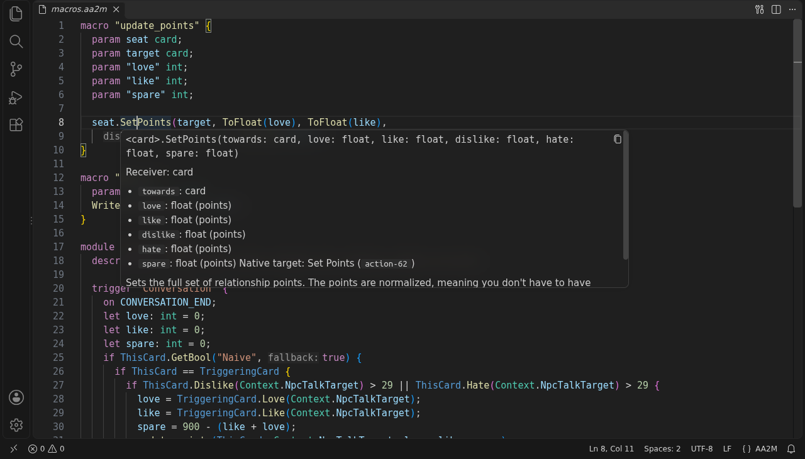
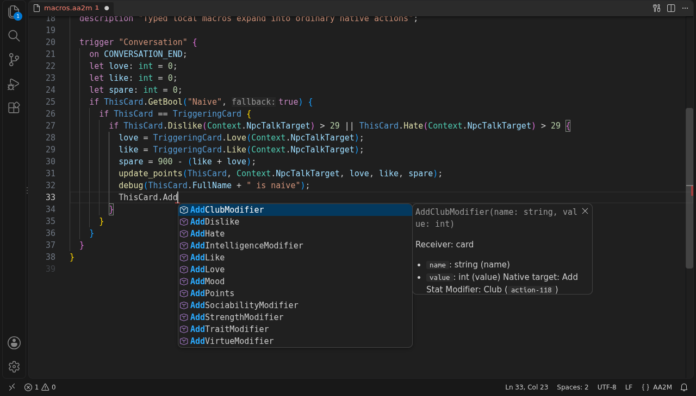
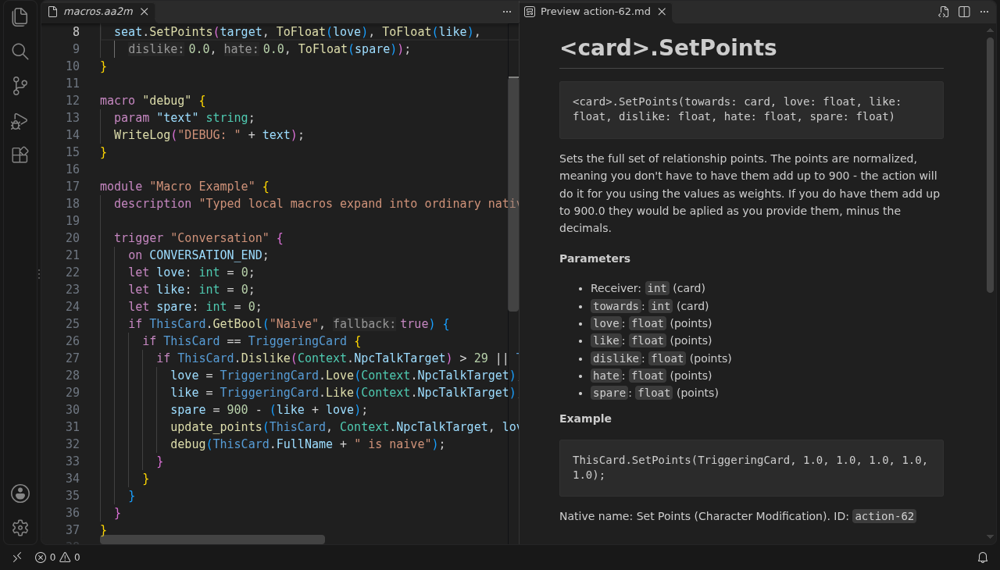
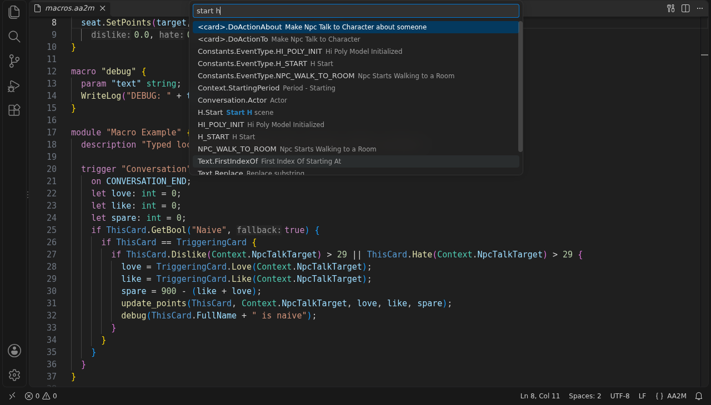

# AA2M Language for VS Code

VS Code support for [AA2Modulus](https://github.com/AA2Depot/AA2Modulus), the
toolchain for writing AAUnlimited modules (`.aa2m`) and libraries (`.aa2mi`)
for Artificial Academy 2. You get colors, errors as you type, suggestions, docs
for every built-in, and compile and decompile right from the editor.

The smart stuff all comes from the AA2Modulus language server. This extension
gets it running and plugs it into VS Code.



## Install

1. Grab the latest `.vsix` from the
   [releases page](https://github.com/AA2Depot/aa2modulus-vscode/releases).
2. In VS Code, open Extensions (Ctrl+Shift+X), click `…` at the top and pick
   **Install from VSIX…**.
3. Open any `.aa2m` file. When it offers to set up the server, click
   **Download Server…** and pick the newest version.

That's it. The **AA2M** item in the status bar shows the server version once
it's running.

The list only has server versions that work with the extension, and the
download gets checked before it's used. Builds exist for Windows and Linux
(64-bit). When a newer server comes out you get a notification (it checks at
most once a day). Run **AA2M: Download Language Server…** whenever you want to
switch versions.

Already have the server somewhere? Run **AA2M: Select Server Executable…** and
point it at `aa2modulus` (`aa2modulus.exe` on Windows).

## What you get



- Suggestions as you type, or with Ctrl+Space. Keywords insert ready-made
  blocks.
- Hover anything to see what it is. Mistakes get a red underline and show up
  in Problems (Ctrl+Shift+M). When a light bulb shows up, Ctrl+. fixes it for
  you.
- F12 on a built-in opens its docs page. On your own names it jumps to the
  definition. Shift+F12 lists every use, and F2 renames it everywhere.
- A `//` comment right above your own macro or variable shows up when you
  hover it, even from another file.
- **AA2M: Browse Built-ins** searches every event, action and value in the
  game, by name or by what it does (try `start h`).

Renaming a module global also renames what the game stores, so other modules
on the same card that read it will still use the old name.





## Writing a module

1. Run **AA2M: New Module** from the command palette (Ctrl+Shift+P). Pick the
   first suggestion to get a module skeleton, then Tab through the parts you
   need to fill in.
2. Save it as a `.aa2m` file.
3. Click the build button at the top right of the editor, or run
   **AA2M: Compile Module**, and pick where to save. AAUnlimited module files
   have no extension, so leave it off.

It compiles what's in the editor, unsaved changes included, and doesn't save
anything for you. Next time it suggests the same location, so you can just
hit Enter.

Only have the compiled module? Run **AA2M: Decompile Module** and pick the
file. The source lands next to it as `<file>.aa2m` (or `<file>-2.aa2m` if
that's taken) and opens.

## When something breaks

Start with **AA2M: Show Language Server Output**. It shows what the extension
tried to run and any errors.

- Server not found, or none set up: run **AA2M: Download Language Server…**
  again, or use **AA2M: Select Server Executable…**.
- Only comments, strings and numbers have colors and nothing else works: the
  folder is probably in Restricted Mode, and the server doesn't run there.
  Click **Manage** in the banner and trust the folder.
- A warning that the server is too old, or Compile Module is missing: download
  the newest server. Too new: update the extension, or download a server it
  supports.
- The server stopped: click **Restart** in the notification, or run
  **AA2M: Restart Language Server**.
- A setting seems ignored: the folder's own `.vscode/settings.json` wins over
  your user settings.

## Settings

Search for `aa2m` in Settings (Ctrl+,). The one you might need is
`aa2m.server.command`, the path to the server, and downloading or selecting a
server fills it in for you. Turn off `aa2m.checkForServerUpdates` if you don't
want it checking GitHub for new servers.

## Compiling from a task

If you run `aa2modulus` yourself, a VS Code task can compile and send errors to
the Problems panel. Add this to `.vscode/tasks.json` and change the paths:

```json
{
  "version": "2.0.0",
  "tasks": [
    {
      "label": "Compile Tutor Module",
      "type": "process",
      "command": "aa2modulus",
      "args": ["compile", "modules/tutor.aa2m", "-o", "build/Tutor", "--diagnostic-format", "short", "--color", "never"],
      "group": "build",
      "problemMatcher": "$aa2m"
    }
  ]
}
```

## Building it yourself

You'll need [Node.js](https://nodejs.org/) 24.

```bash
npm install
npm test
```

Open the folder in VS Code and press F5 to try your build in a new window. How
the code is laid out is in [docs/architecture.md](docs/architecture.md).

## License

[GPL-3.0-only](LICENSE), same as AA2Modulus.

Copyright (C) 2026 R00taryEnginE
